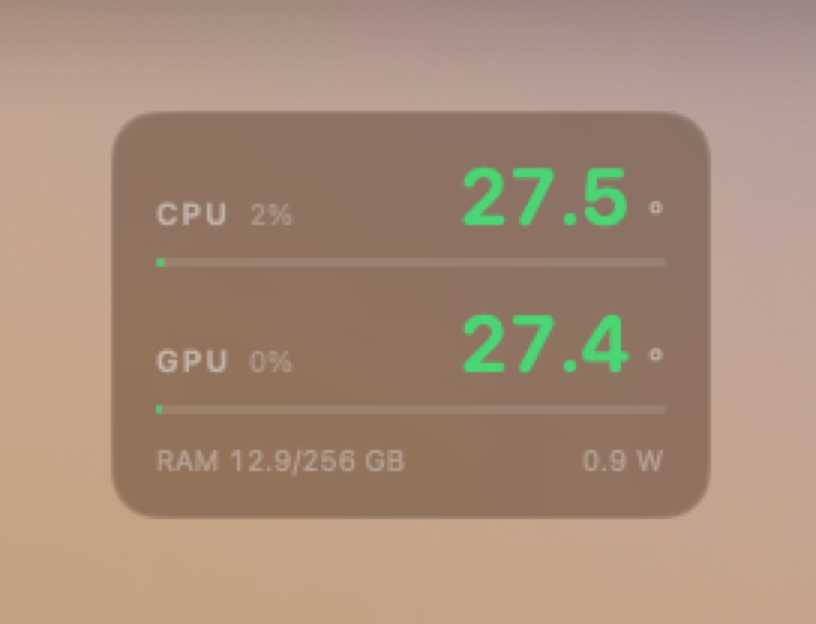

<div align="center">



# M5Vitals

**Minimal CPU / GPU temperature on your desktop.**

[中文](#中文) · [English](#english) · [日本語](#日本語)

</div>

---

## 中文

### 这是什么

一个极简的 macOS 桌面小组件：把 **CPU / GPU 温度**贴在桌面上（壁纸之上、所有窗口之下），顺手带上占用率、内存和芯片功耗。没有标题、没有图标、没有多余装饰，只有四个数字。

```
CPU  1%                    26.5°
────────────────────────────────
GPU  2%                    26.4°
────────────────────────────────
RAM 10.9/256 GB           1.1 W
```

温度按档位变色：< 68 °C 绿色，68–80 琥珀，80–90 橙色，90+ 红色。

### 实测机型

| 项目 | 值 |
|---|---|
| 芯片 | **Apple M5 Ultra（30 核：10 + 20）** |
| 机型 | Mac Studio (Mac17,15)，256 GB 统一内存 |
| 系统 | macOS 27 |
| 状态 | 已验证：CPU/GPU 温度与风扇、功耗读数与 `macmon` 逐帧一致；空闲约 27–30 °C / 2–6 W，GPU 满载时实测 2496–2502 rpm、184 W |

Apple Silicon **M1 / M2 / M3 / M4 / M5 全系适用**（只要 `macmon` 能跑，这个小组件就能跑）。

### 数据来源（重要）

温度与功耗**不是**本项目实现的。本项目把传感器读取整个交给开源项目 **[macmon](https://github.com/vladkens/macmon)**（MIT 许可，作者 [@vladkens](https://github.com/vladkens)）：

- 它负责通过 **SMC + IOReport** 读取 CPU/GPU 温度、占用率、功耗、风扇转速，**全程不需要 `sudo`**
- 它在本机 `127.0.0.1:41414` 暴露 JSON，本小组件每 2 秒取一次
- 本项目只做三件事：把 JSON 解析出来、画成卡片、贴在桌面层

如果 macmon 帮到你，请去给它点个 star ⭐。

### 安装

```bash
# 1) 传感器后端（无需 sudo）
brew install macmon
macmon serve --install --host 127.0.0.1 --port 41414

# 2) 编译小组件（只需要 Xcode Command Line Tools，不需要完整 Xcode）
git clone https://github.com/qinchuqiaox-creator/M5Vitals.git
cd M5Vitals
./build.sh            # → ~/Applications/M5Vitals.app

# 3) 启动
open ~/Applications/M5Vitals.app
```

开机自启（可选）：

```bash
sed "s|\$HOME|$HOME|g" launchagent/dev.example.m5vitals.plist \
  > ~/Library/LaunchAgents/dev.example.m5vitals.plist
launchctl load ~/Library/LaunchAgents/dev.example.m5vitals.plist
```

### 用法

- **拖动**：直接拖卡片，位置会被记住
- **菜单栏 🌡**：Show / Hide、Move To（右上/左上/右下/左下/居中）、Float on Top、Quit
- **Float on Top**：打开后卡片浮在所有窗口之上，任何时候都可见、可拖；关掉则回到桌面层
- 窗口会**盖住**卡片——这是"桌面小组件"的正常行为，被盖住时点击会被那个窗口接收

### 为什么不做成系统 WidgetKit 小组件

WidgetKit 的时间线刷新是按**分钟**预算的，做不出 2 秒实时的温度；而且需要完整的 Xcode、签名和 App Group。这里用一个 `NSPanel`（`level = -1`，`collectionBehavior = [.canJoinAllSpaces, .stationary]`）实现了同样的"桌面吸附"效果。

### 许可

MIT。

---

## English

### What it is

A deliberately minimal macOS desktop widget: **CPU / GPU temperature** pinned to the desktop layer (above the wallpaper, below every window), with utilisation, memory and package power along for the ride. No title, no icon, no decoration — four numbers.

### Tested on

| | |
|---|---|
| Chip | **Apple M5 Ultra** (30 cores: 10 + 20) |
| Machine | Mac Studio (Mac17,15), 256 GB unified memory |
| OS | macOS 27 |
| Result | CPU/GPU temperatures, fan and power readouts verified against `macmon`; ~27–30 °C / 2–6 W idle, 2496–2502 rpm and 184 W under a full GPU load |

Works on any Apple Silicon Mac (**M1 → M5**) that can run `macmon`.

### Data source (please read)

The sensors are **not** implemented here. All hardware reading is delegated to the open-source project **[macmon](https://github.com/vladkens/macmon)** by [@vladkens](https://github.com/vladkens) (MIT):

- reads CPU/GPU temperature, utilisation, power and fan RPM via **SMC + IOReport**, with **no `sudo`**
- serves a JSON snapshot on `127.0.0.1:41414`
- M5Vitals polls it every 2 seconds, decodes it with `Codable`, and draws the card

If macmon is useful to you, go star it ⭐.

### Install

```bash
brew install macmon
macmon serve --install --host 127.0.0.1 --port 41414

git clone https://github.com/qinchuqiaox-creator/M5Vitals.git
cd M5Vitals && ./build.sh   # needs only Xcode Command Line Tools
open ~/Applications/M5Vitals.app
```

### Why not WidgetKit?

WidgetKit timelines are budgeted in minutes — useless for a 2-second temperature readout — and shipping an extension means Xcode, signing and an App Group. A borderless `NSPanel` at window level `-1` behaves the same way and updates in real time.

### Licence

MIT.

---

## 日本語

### これは何か

macOS のデスクトップに **CPU / GPU 温度** を表示する、極小のウィジェットです。壁紙の上・すべてのウィンドウの下（デスクトップレイヤー）に常駐し、使用率・メモリ・パッケージ電力も一緒に表示します。タイトルもアイコンも飾りもなし、数字だけ。

### 動作確認済み

| | |
|---|---|
| チップ | **Apple M5 Ultra**（30 コア：10 + 20） |
| マシン | Mac Studio (Mac17,15)、ユニファイドメモリ 256 GB |
| OS | macOS 27 |
| 結果 | CPU/GPU 温度・ファン・電力を `macmon` と突き合わせて検証済み。アイドル時 27–30 °C / 2–6 W、GPU 全負荷時 2496–2502 rpm / 184 W |

`macmon` が動く Apple Silicon（**M1〜M5**）であれば動作します。

### データの取得元（重要）

センサー読み取りは本プロジェクトでは実装していません。すべてオープンソースの **[macmon](https://github.com/vladkens/macmon)**（MIT、作者 [@vladkens](https://github.com/vladkens)）に委ねています。

- **SMC + IOReport** 経由で CPU/GPU 温度・使用率・電力・ファン回転数を取得（**`sudo` 不要**）
- `127.0.0.1:41414` で JSON を公開
- 本ウィジェットは 2 秒ごとに取得して描画するだけ

macmon が役に立ったら、ぜひスターを ⭐

### インストール

```bash
brew install macmon
macmon serve --install --host 127.0.0.1 --port 41414

git clone https://github.com/qinchuqiaox-creator/M5Vitals.git
cd M5Vitals && ./build.sh   # Xcode Command Line Tools のみで可
open ~/Applications/M5Vitals.app
```

### ライセンス

MIT。

---

## Credits

- **[macmon](https://github.com/vladkens/macmon)** — the entire sensor layer (SMC / IOReport, no sudo). MIT.
- Built with SwiftUI; no third-party UI dependencies.
